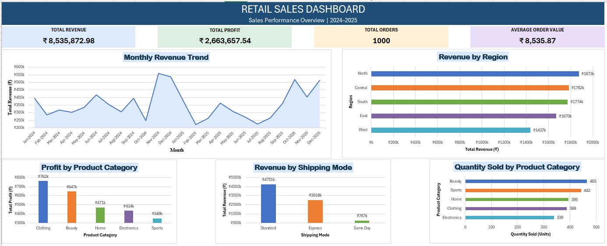

# Retail Sales Analysis & Dashboard | Excel

## Project Overview

This project focuses on analyzing e-commerce sales data using Microsoft Excel. The objective was to transform raw sales data into meaningful insights through data cleaning, data transformation, exploratory analysis, PivotTables, charts, and an interactive sales dashboard.

The project demonstrates a complete Excel-based data analysis workflow, from preparing the dataset to presenting key business performance metrics in a visual dashboard.

## Objectives

- Clean and validate the raw sales dataset.
- Prepare the data for analysis using Excel formulas.
- Analyze revenue and profit across product categories and regions.
- Compare sales performance across shipping modes.
- Track monthly revenue trends.
- Build a dashboard to summarize key performance indicators and findings.

## Tools & Skills

- **Microsoft Excel**
- Data Cleaning and Validation
- Excel Formulas and Functions
- Data Transformation
- PivotTables and PivotCharts
- Data Visualization
- Dashboard Design
- Business Insights

## Dataset

The project uses an e-commerce orders dataset containing order dates, customer details, regions, product categories, quantities, prices, discounts, revenue, profit, and shipping modes.

- **Records:** 1,000
- **Time Period:** 2024–2025
- **Data Format:** Excel workbook

## Project Workflow

1. **Data Cleaning:** Checked missing values, duplicates, data types, invalid values, and data consistency.
2. **Data Transformation:** Created helper columns for Year, Month, Month-Year, Profit Margin, and Month-Year sorting.
3. **KPI Calculation:** Calculated total revenue, total profit, order count, and average order value.
4. **Exploratory Analysis:** Used PivotTables to analyze sales performance by category, region, month, and shipping mode.
5. **Data Visualization:** Created charts to communicate revenue trends, regional performance, product-category profitability, shipping-mode revenue, and quantity sold.
6. **Dashboard Development:** Combined the KPI metrics and five charts into a formatted sales dashboard.

## Key Performance Indicators

| KPI | Result |
|---|---:|
| Total Revenue | ₹8,535,872.98 |
| Total Profit | ₹2,663,657.54 |
| Total Orders / Records Counted | 1,000 |
| Average Order Value | ₹8,535.87 |

*Note: The order count assumes each record represents one order. Unique Order IDs should be verified if the dataset contains repeated IDs.*

## Dashboard Components

The dashboard includes:

- Monthly Revenue Trend
- Revenue by Region
- Profit by Product Category
- Revenue by Shipping Mode
- Quantity Sold by Product Category

## Key Analytical Questions

- How does revenue change from month to month?
- Which regions contribute the most revenue?
- Which product categories generate the most revenue and profit?
- How does revenue vary across shipping modes?
- Which product categories have the highest sales quantities?

## Dashboard Preview

## Files Included

| File | Description |
|---|---|
| `e_commerce_order_dataset.xlsx` | Excel workbook containing the dataset, cleaning log, analysis, PivotTables, and dashboard |
| `retail_sales_dashboard.jpeg` | Dashboard preview image |

## What I Learned

Through this project, I strengthened my understanding of Excel-based data analysis, data validation, formula-driven transformations, PivotTables, chart formatting, KPI development, and dashboard layout design. I also learned how to organize analytical results into a clear and accessible business reporting dashboard.

## Conclusion

This project demonstrates how Microsoft Excel can be used to clean, analyze, and visualize retail sales data. The resulting dashboard provides a consolidated view of sales performance and supports data-driven business analysis.
